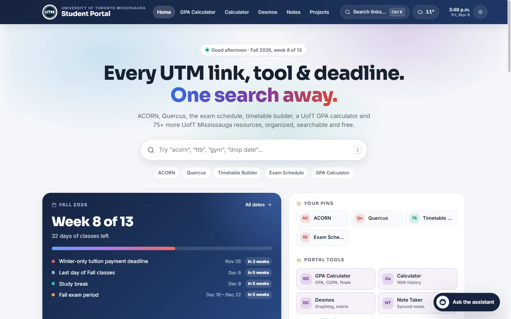
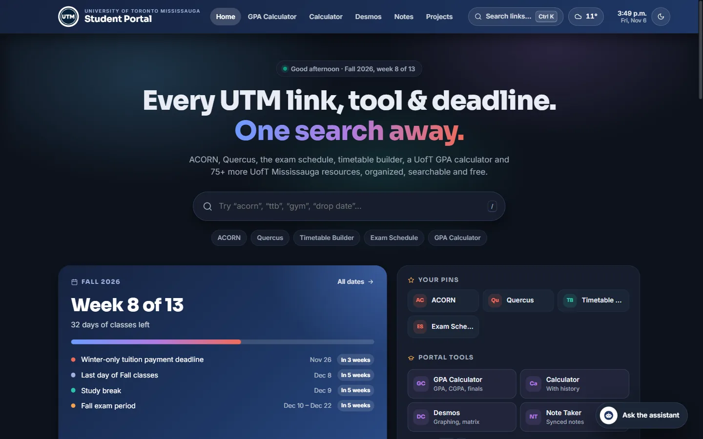
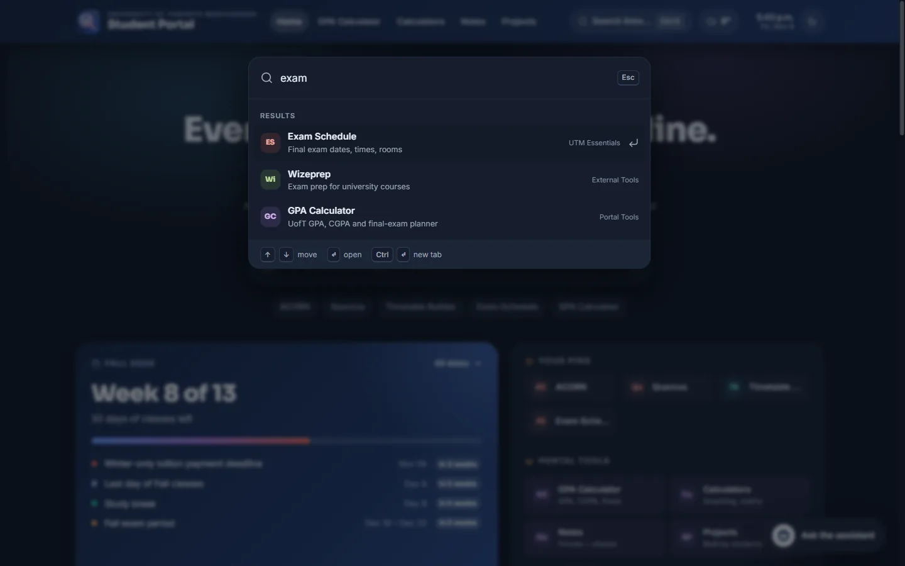
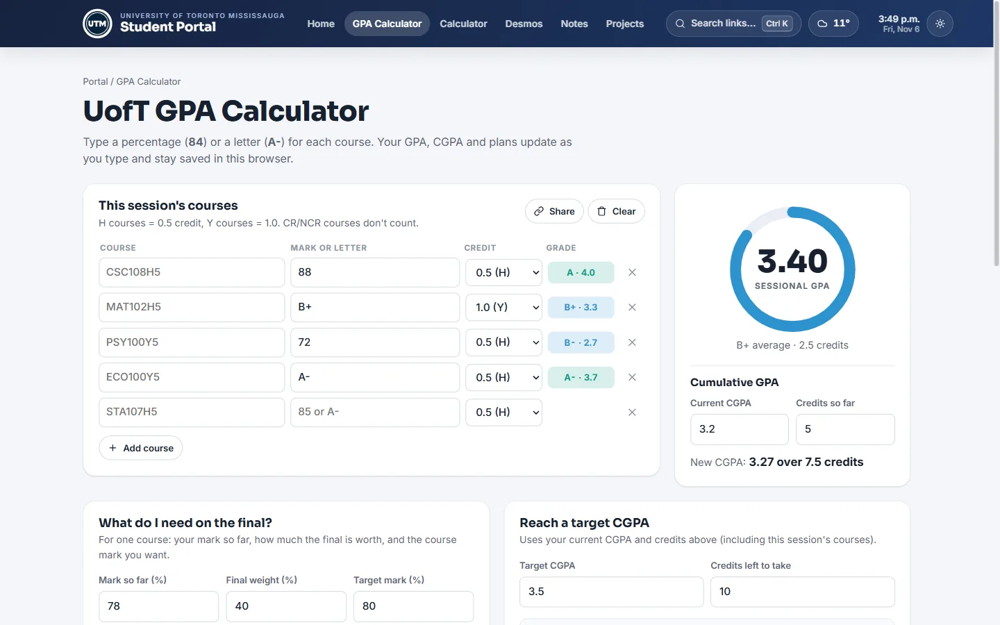
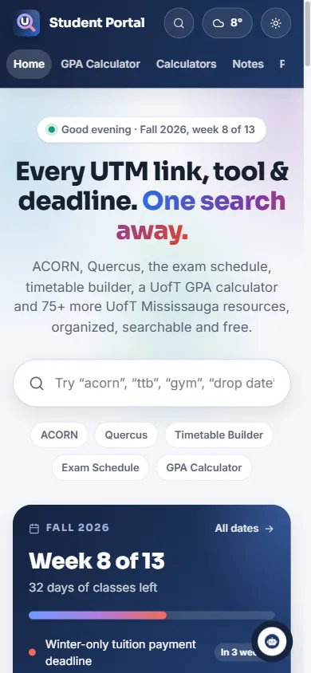

<div align="center">

<a href="https://utmstudentportal.netlify.app/"></a>

# UTM Student Portal: Every UofT Mississauga Link, Tool & Deadline in One Search

**A free, fast, installable portal for University of Toronto Mississauga (UTM) students.** ACORN, Quercus, the exam schedule, the timetable builder, a UofT GPA calculator and 75+ more UTM resources, with a live term tracker and Mississauga weather.

[](https://utmstudentportal.netlify.app/)

[](https://github.com/AbdulDevHub/UTM-Student-Portal/actions/workflows/ci.yml)
[](https://github.com/AbdulDevHub/UTM-Student-Portal/actions/workflows/link-check.yml)


[](LICENSE)

<a href="https://utmstudentportal.netlify.app/"></a>

</div>

## Why it exists

UTM students juggle a dozen UofT systems: ACORN for enrolment, Quercus for courses, the exam schedule, Degree Explorer, the library, CLNx, UTORMFA, the shuttle… and the links are scattered across several university websites. This portal puts every one of them a keystroke away and adds the things students check every day: what week of term it is, what deadline is next, the weather on campus, and what GPA they're on track for.

> Not an official University of Toronto website. Built by a UTM student, for UTM students.

## Features

| | |
|---|---|
| **⌘K / Ctrl+K quick search** | A typo-tolerant search over every link on every page. `ttb` finds Timetable Builder, `quercis` finds Quercus, `gym` finds the RAWC. |
| **Pin your links** | Star any link to pin it to the top of the page. Recently opened links show up automatically. Saved in your browser, no account needed. |
| **Live term tracker** | "Week 8 of 13", a progress bar for the term, and a countdown to the next UTM deadline, break or exam period. |
| **Live Mississauga weather** | Current conditions and a 4-day forecast for campus, from [Open-Meteo](https://open-meteo.com/) (free, no API key). |
| **UofT GPA calculator** | Converts marks or letters to the UofT 4.0 scale, gives you your sessional GPA and CGPA, works out the final-exam mark you need, plans a target CGPA, and makes shareable links. |
| **Quick math + calculators** | Type a sum like `85*0.4+72*0.6` into any search box for an instant answer (a safe parser, no `eval`). Desmos scientific, graphing, matrix and geometry calculators sit in one tabbed page. |
| **Notes** | Write, search and pin course notes saved in your browser (no account). Share a note as a link and back everything up to a file. |
| **Student Projects** | A showcase for apps, games and designs built by UTM students, with a submission form. |
| **Installable and offline** | A PWA with a service worker: add it to your home screen and the main pages still load without a connection. |
| **Dark mode** | Follows your system setting, or toggle it yourself. |

<details>
<summary><b>More screenshots</b></summary>

| Dark mode | Ctrl+K search |
|---|---|
|  |  |

| GPA calculator | Mobile |
|---|---|
|  |  |

</details>

## Built with

Plain **HTML, CSS and JavaScript (ES modules)**, with no framework, no bundler and zero npm dependencies. Netlify serves the repo as-is.

- **Data-driven:** every link lives in [`js/data/links.js`](js/data/links.js) and term dates in [`js/data/dates.js`](js/data/dates.js).
- **Tiny build script:** [`scripts/build.mjs`](scripts/build.mjs) stamps the shared header/footer into each page, renders the link directory as static HTML (crawlable and fast), generates the FAQ and its `FAQPage` structured data, the sitemap, and the service worker cache list.
- **Tested:** unit tests for the search ranking, the GPA maths, the term calendar and the calculator parser (`node --test`).
- **Self-maintaining:** a weekly GitHub Action checks all 75+ external links and opens an issue when one breaks. Lighthouse runs on every push.
- **SEO:** unique titles, descriptions and canonicals; Open Graph/Twitter cards; `WebSite`, `WebApplication`, `FAQPage` and `BreadcrumbList` JSON-LD; a sitemap; clean URLs with 301s from the old ones.

## Run it locally

```bash
git clone https://github.com/AbdulDevHub/UTM-Student-Portal.git
cd UTM-Student-Portal
npm run serve        # http://localhost:4173 (Node 20+, nothing to install)
```

| Command | What it does |
|---|---|
| `npm run build` | Regenerate pages, sitemap and service worker after editing links, dates or partials |
| `npm run check` | Verify the build is up to date and run the unit tests (what CI runs) |
| `npm run links` | Check every external link is still alive |

## Add or fix a link

1. Edit [`js/data/links.js`](js/data/links.js). Each link is one line: `name`, `url`, a short `desc`, and `aliases` people might type.
2. Run `npm run build`, then `npm run check`.
3. Open a pull request.

Not a coder? [Suggest a link](https://github.com/AbdulDevHub/UTM-Student-Portal/issues/new?template=suggest-link.yml) or [submit your project](https://github.com/AbdulDevHub/UTM-Student-Portal/issues/new?template=project-submission.yml) using the issue forms.

## Project structure

```
├── index.html              Home: search, term tracker, pins, link directory, FAQ
├── gpa-calculator/         UofT GPA / CGPA / final-exam calculator
├── desmos/                 Desmos calculators (tabs)
├── notes/                  Notes saved in the browser (share links, backup)
├── student-projects/       Student project gallery
├── css/style.css           One stylesheet for the whole site
├── js/
│   ├── data/               links.js, dates.js: the content
│   ├── lib/                Pure logic (search, gpa, term, calc), unit-tested
│   └── *.js                Page scripts, Ctrl+K palette, weather, store
├── images/                 Icons, social image, README screenshots
├── scripts/                Build-only: build, dev server, link checker,
│                           shared partials/, unit tests/, Lighthouse config
└── sw.js                   Service worker (offline + install)
```

## Contributing

Issues and pull requests are welcome, especially new links, fixed links and accessibility improvements. Please run `npm run check` before opening a PR.

## License

[MIT](LICENSE) © Abdul Hadi Khan. University of Toronto names and links belong to their owners; this project is independent and unofficial.
